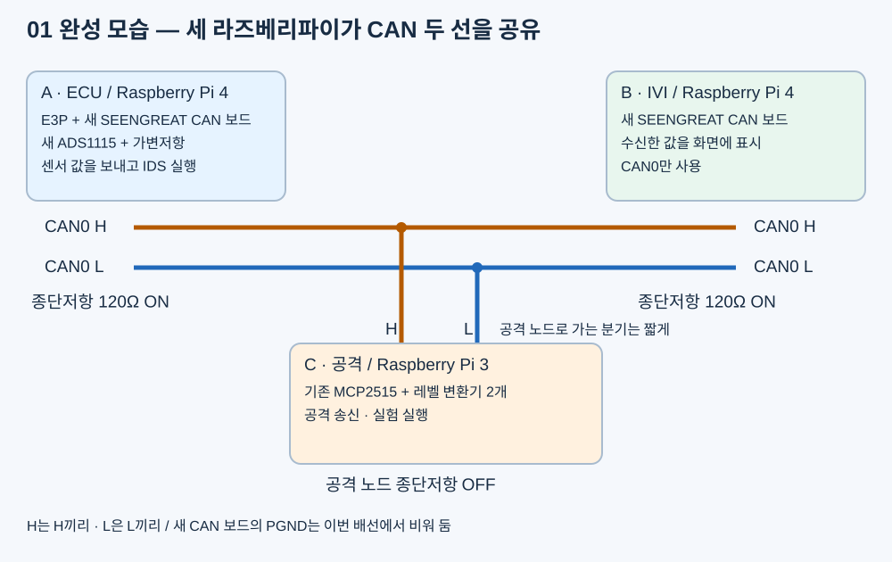
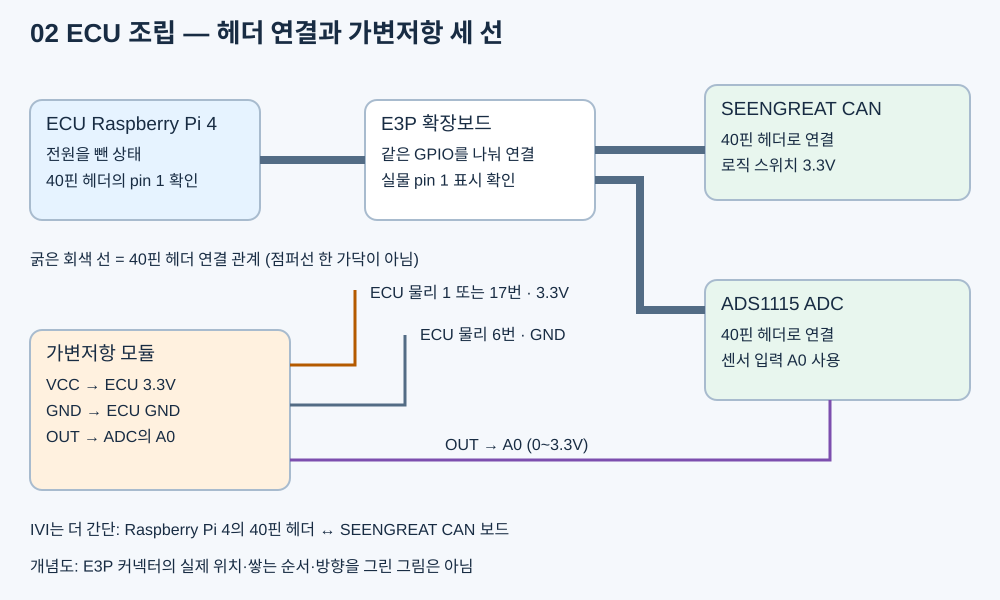
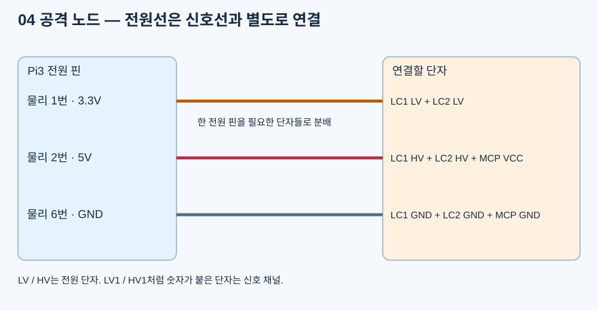
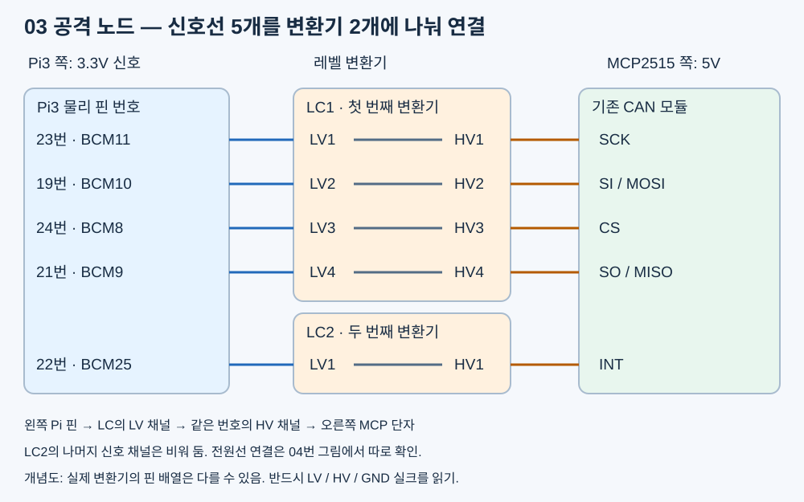

# 그림으로 따라 하는 3노드 회로 변경과 실험

브라우저에서 그림·핀 표를 크게 보려면 [3노드 HTML 배선 지도](../../../하드웨어%20정보/ECU_IVI_RPi3_3노드_배선가이드.html)를 사용하세요. IVI 터치 화면의 DSI·전원 연결도 포함합니다.

2026-10-21 사용자 지정 장비 기준. 물리 조립·전압·CAN 통신 성공은 아직 확인하지 않았다. 작업 상태는 [CHG-022](../../aidlc/changes/CHG-022/aidlc-state.md)에 기록한다.

처음 조립한다면 **1~5번만 순서대로** 따라가세요. 6~7번은 회로 연결과 정상 통신이 끝난 뒤 진행하는 실험 설명입니다. 그림은 연결 관계를 보여 주는 개념도입니다. 보드의 실제 단자 위치나 장착 방향은 실물에 인쇄된 이름을 기준으로 확인하세요.

### 먼저 알아둘 말 세 가지

| 표기 | 쉽게 말하면 | 이번 작업에서 읽는 방법 |
|---|---|---|
| 물리 핀 번호 | 40핀 헤더에서 핀의 자리 번호 | 점퍼선을 꽂을 때 사용. 예: **물리 23번** |
| BCM 번호 | 라즈베리파이가 GPIO를 부르는 이름 | 물리 23번은 **BCM11**. 서로 다른 핀이 아니라 같은 핀의 두 이름 |
| 보드의 P 번호 | SEENGREAT의 스위치 선택 이름 | **P11을 물리 11번으로 읽지 않기**. 스위치에 적힌 글자를 찾기 |

**조립 순서:** 전원 빼기 → ECU·IVI에 새 보드 연결 → Pi3에 기존 모듈 연결 → CAN H/L 연결 → 점검 후 전원 켜기.

## 1. 먼저 부품을 세 묶음으로 나누기



기존 회로에서 **MCP2515 CAN 모듈과 레벨 변환기를 떼어 Pi3 쪽으로 옮깁니다.** ECU·IVI에는 새 SEENGREAT 보드를 사용합니다. 새 ADS1115는 ECU에만 연결하고 기존 ADC는 분리합니다.

| 노드 | 장착 | 역할 |
|---|---|---|
| A: ECU RPi4 | E3P에 SEENGREAT 220779와 Seeed ADS1115 103030279 연결 | 센서·제품 ECU·Python IDS |
| B: IVI RPi4 | SEENGREAT 220779 | 인증·수신·Qt 표시 |
| C: 공격 RPi3 | 기존 8MHz MCP2515/TJA1050 + 4채널 레벨 변환기 2개 | 공격·실험 제어 |

그림의 주황색은 CANH, 파란색은 CANL입니다. **실제 전선 색은 달라도 되지만 연결할 단자 이름은 같아야 합니다.** H와 L을 서로 바꾸지 마세요. CAN1과 RS485는 이번에 사용하지 않습니다. CAN 배선은 각 노드의 조립이 끝난 뒤 5번에서 연결합니다.

## 2. ECU와 IVI의 새 보드



### 손으로 하는 작업

1. 세 라즈베리파이의 전원 케이블을 모두 뽑습니다.
2. **ECU:** Pi의 40핀 헤더 → E3P → CAN 보드와 ADC 보드로 연결합니다. 위 그림의 굵은 선은 **40핀 커넥터 연결**입니다. SPI 신호마다 점퍼선을 따로 추가하라는 뜻이 아닙니다.
3. **IVI:** Pi의 40핀 헤더에 CAN 보드를 연결합니다. E3P와 ADC는 달지 않습니다.
4. 양쪽 CAN 보드에서 아래 표의 스위치 표시를 찾아 맞춥니다. 스위치의 좌우 방향을 추측하지 말고 실물의 **ON 표시**를 확인합니다.

| 찾을 표시 | ECU·IVI 둘 다 설정 | 뜻 |
|---|---|---|
| 로직 전압 선택 | **3.3V** | Pi의 GPIO 신호 전압에 맞춤 |
| P11 / P10 | **P11 ON / P10 OFF** | CAN0의 칩 선택 신호 |
| P6 / P23 | **P6 ON / P23 OFF** | CAN0의 인터럽트 신호 |
| 외부 DC 전원 입력 | **비워 둠** | 이번에는 Pi의 전원 입력으로 공급 |

**여기서 확인:** 헤더가 한 칸 밀리지 않았는지, 서로의 pin 1이 맞는지 확인합니다. E3P의 실제 커넥터 모양·방향은 아직 확인하지 못했으므로 그림처럼 억지로 쌓지 마세요. 실물 방향 확인 전에는 전원을 넣지 않습니다.

<details>
<summary>핀 번호 대응과 제조사 근거 자세히 보기</summary>

전원을 모두 제거하고 40핀 헤더의 **물리 pin 1 방향**을 맞춘다. ECU는 E3P의 GPIO 분배 커넥터에 CAN 보드와 ADC를 각각 연결한다. E3P는 포트별로 GPIO 번호가 새로 생기는 장치로 취급하지 않는다. 연결 전 같은 번호의 전원·GPIO 연속성과 장착 간섭을 확인한다. [E3P 구매 링크](https://www.devicemart.co.kr/goods/view?no=1361333)는 현재 자동 열람에 실패했으므로 실물 방향·커넥터 구조는 확인 대상이다.

SEENGREAT 두 개 모두 로직 스위치를 **3.3V**로 둔다. 공급은 Pi의 5V 헤더를 통해 받는다. 이번 구성에서는 각 Pi의 기존 전원 입력만 사용하고 보드의 외부 DC 입력을 추가 연결하지 않는다. 제조사 회로는 Pi 전원과 외부 전원 경로를 연결하므로 이중 급전을 임의 적용하지 않는다.

CAN0만 사용하는 설정: 제조사 기본 선택 중 **P11 ON / P10 OFF, P6 ON / P23 OFF**를 확인한다. 이는 SPI0 CE1(BCM7/물리26), INT BCM25/물리22다. P 표기는 wiringPi 번호이며 물리 pin 번호가 아니다. 공통 SPI는 MOSI BCM10/물리19, MISO BCM9/물리21, SCLK BCM11/물리23이다. [제조사 안내](https://seengreat.com/wiki/83/rs485-dual-can-i).

</details>

### 설정 파일은 조립 완료 후 적용

아래 설정은 **ECU와 IVI 각각**에 적용합니다. 공격 Pi3에는 4번의 다른 설정을 사용합니다.

부팅 설정 파일은 실제 OS에 따라 `/boot/firmware/config.txt` 또는 `/boot/config.txt`다. 기존 CAN overlay를 백업·확인하고 해당 노드의 이전 8MHz CAN 설정을 아래로 교체한다. 같은 SPI 장치에 두 overlay를 중복 선언하지 않는다.

```ini
dtparam=spi=on
dtoverlay=mcp2515,spi0-1,oscillator=16000000,interrupt=25
```

CAN1과 UART overlay는 추가하지 않는다. 제조사 기본 예제 전체를 붙이면 사용하지 않는 CAN1·UART까지 활성화된다. CAN0 한 개만 활성화한 뒤 Linux `can0`와 실제 CAN0 단자의 대응을 확인한다.

회로도 V1.2에서 CAN 단자의 세 번째 선은 **PGND(보호 접지)**이며, 트랜시버의 절연 신호 접지 GND-T와 R16 1MΩ·C11 1nF의 병렬망으로 연결돼 있다. 일반 GPIO GND와 같은 핀으로 취급하지 않는다. 본 조립은 제조사 CAN 예제처럼 세 노드의 H/H·L/L 신호선부터 연결하고 PGND는 미연결로 둔다. 별도 보호 접지 구성은 장비 접지 설계에 맞춰 결정하며 Pi GPIO GND나 기존 MCP GND와 임의 직결하지 않는다. 실물 단자 실크를 기준으로 H/L/PGND를 식별한다. [제조사 V1.2 회로도](https://seengreat.com/upload/file/83/RS485-Dual-CAN-I-V1.2.pdf).

## 3. ECU의 ADS1115

ADC는 가변저항의 전압을 읽어 숫자로 바꿔 주는 보드입니다. 위 02번 그림의 아래쪽처럼 **가변저항에서 나오는 세 선**만 먼저 찾아 연결하세요.

1. `VCC` → ECU의 **3.3V**: 물리 1번 또는 17번.
2. `GND` → ECU의 **GND**: 예를 들어 물리 6번.
3. `OUT` → ADS1115의 **A0 또는 AIN0**.

**여기서 확인:** `OUT`을 Pi의 GPIO에 직접 꽂는 것이 아니라 **ADC의 입력 A0**에 꽂습니다. 이 설명은 VCC/GND/OUT이 표시된 가변저항 모듈 기준입니다. 단자 표기가 다르면 같은 위치라고 추측해서 연결하지 마세요.

사용자 링크의 제품은 [Seeed 103030279](https://www.devicemart.co.kr/goods/view?no=12092942)다. 40핀을 E3P에 방향 맞춰 연결하고, I²C SDA는 BCM2/물리3, SCL은 BCM3/물리5를 사용한다. 기본 주소 `0x48`을 유지한다. 기존 ADC와 새 ADC를 같은 주소로 동시에 연결하지 않는다. [Seeed 설명·핀 그림](https://wiki.seeedstudio.com/4-Channel_16-Bit_ADC_for_Raspberry_Pi-ADS1115/).

| 가변저항 모듈 | 연결 |
|---|---|
| VCC | ECU 3.3V(물리1 또는17) |
| GND | ECU GPIO GND |
| OUT | 새 ADC의 AIN0/A0 |

ADC 커넥터의 A0/GND/전원 실크를 확인한다. Grove 케이블 색만으로 A0를 결정하지 않는다. 가변저항 입력은 0~3.3V이며 가상 팩 30~42V를 직접 인가하지 않는다. 기존 코드의 PGA ±4.096V는 허용 전원 전압을 늘리는 설정이 아니다.

ECU 부팅 설정에는 `dtparam=i2c_arm=on`을 적용한다. 현재 `LinuxI2cTransport`는 `/dev/i2c-1`을 직접 열고 `I2C_SLAVE`로 주소를 소유한다. 제조사 IIO 예제의 `dtoverlay=ads1115`를 함께 추가하면 커널 드라이버가 주소를 소유할 수 있으므로 이 경로에서는 추가하지 않는다. 다른 ADC 프로세스를 종료하고 기존 ADC 단독 시험을 수행한다. 입력 보드 교체 후 끝점 오차는 새로 측정하며 이전 보드의 실측을 새 보드 증거로 사용하지 않는다.

## 4. RPi3로 기존 CAN 모듈 이동

레벨 변환기는 **Pi의 3.3V 신호와 기존 CAN 모듈의 5V 신호 사이를 연결하는 부품**입니다. 여기서는 신호가 다섯 개여서 4채널 변환기 한 개로는 부족합니다. 첫 번째 변환기를 LC1, 두 번째를 LC2라고 부르겠습니다.

### 4-1. 먼저 전원선 연결



`LV`와 `LV1`은 다릅니다. **숫자 없는 LV/HV는 전원**, 숫자 있는 LV1/HV1 등은 아래에서 연결할 신호 단자입니다. 그림에서 한 선이 여러 단자로 가는 부분은 브레드보드의 전원 레일 등으로 분배하고, 분배된 각 단자가 실제로 이어지는지 전원을 뺀 상태에서 확인합니다.

### 4-2. 다음으로 신호선 다섯 개 연결



그림을 **한 줄씩 왼쪽에서 오른쪽으로** 따라가세요. 예를 들어 첫 줄은 `Pi3 물리 23번 → LC1 LV1`, 그리고 `LC1 HV1 → MCP SCK`입니다. **LV1과 HV1을 점퍼선으로 직결하지 않습니다.** 변환기 내부 회로가 두 단자를 이어 줍니다. LC2의 남는 채널은 비워 둡니다.

기존 배선 기록은 5V TJA1050 모듈이며, 4채널 컨버터 **두 개**로 SPI 4신호와 INT 1신호를 처리한다. 사용자가 제공한 컨버터 링크는 유사 제품이므로 실제 모듈의 HV/LV 표시를 우선한다.

| RPi3 물리 핀(BCM) | 변환 경로 | MCP2515 |
|---|---|---|
| 23 (11) | LC1 LV1 ↔ HV1 | SCK |
| 19 (10) | LC1 LV2 ↔ HV2 | SI/MOSI |
| 24 (8) | LC1 LV3 ↔ HV3 | CS |
| 21 (9) | LC1 LV4 ↔ HV4 | SO/MISO |
| 22 (25) | LC2 LV1 ↔ HV1 | INT |

두 LC의 LV=Pi 3.3V, HV=Pi 5V, GND=Pi GND. MCP VCC=5V, GND 공통. 5V MISO·INT를 GPIO에 직결하지 않는다. 기존 모듈 실물의 `8.000` 표기를 재확인한다.

```ini
dtparam=spi=on
dtoverlay=mcp2515,spi0-0,oscillator=8000000,interrupt=25
```

기존에 검증한 SPI 속도 제한이 있다면 유지한다. 보유 양방향 레벨 변환기의 SPI 신호 품질은 제품·배선 길이에 따라 달라진다. CAN 오류 카운터를 확인하고 성공한 SPI 속도를 기록한다. ADC·정상 ECU·IDS는 RPi3에서 실행하지 않는다.

## 5. 전원 투입 후 확인

### 5-1. 전원을 켜기 전에 CAN 두 선 연결

01번 그림으로 돌아가서 세 모듈의 **H는 H끼리, L은 L끼리** 연결합니다. ECU와 IVI를 잇는 선의 중간에서 공격 노드로 짧게 분기하세요. 세 방향으로 긴 선을 뻗는 별 모양 배선은 피합니다.

**종단저항**은 CAN 선 양 끝에 넣는 120Ω 저항입니다. ECU와 IVI 쪽은 켜고(ON), 공격 노드 쪽은 끕니다(OFF). 보드마다 스위치·점퍼 방식이 다를 수 있으므로 실물의 120Ω/종단저항 표시를 확인하세요.

- [ ] ECU·IVI CAN 보드의 로직 선택이 모두 3.3V다.
- [ ] 가변저항 VCC는 3.3V이고 OUT은 ADC A0로 간다.
- [ ] 공격 노드는 전원선과 신호선 다섯 개가 각각 연결됐다.
- [ ] 새 CAN 보드의 PGND와 외부 DC 입력은 비어 있다.
- [ ] ECU·IVI 종단저항만 ON이고 공격 노드는 OFF다.
- [ ] **전체 전원을 뺀 상태에서** 멀티미터 저항 모드로 H–L 사이를 측정했다. 약 60Ω이면 두 120Ω이 병렬로 연결된 예상값이다. 약 40Ω이면 저항 세 개가 켜졌는지 확인한다.

### 5-2. 각 노드의 부팅 설정 적용 후 재부팅

ECU·IVI에는 2번의 **16MHz / spi0-1**, 공격 Pi3에는 4번의 **8MHz / spi0-0** 설정을 적용합니다. ECU에는 3번의 I²C 활성화도 필요합니다. 아래 명령은 **각 노드의 터미널에서** 실행합니다.

각 노드를 재부팅한 뒤 CAN을 500kbit/s로 설정한다. 이미 실행 중인 송신 프로그램을 먼저 종료한 준비 상태에서 실행한다.

```sh
sudo ip link set can0 down
sudo ip link set can0 up type can bitrate 500000
ip -details -statistics link show can0
candump can0
```

세 노드의 bitrate·ERROR-ACTIVE와 정상 프레임 수신을 확인한다. ECU→IVI 정상 인증·ADC 변화 표시를 먼저 검증하고 공격 RPi3는 수신부터 확인한다. 부팅 실패, bus-off, 증가하는 RX/TX 오류가 있으면 해당 로그와 실제 배선을 점검한다. 기존 키는 A/B의 배치 정책을 유지한다.

## 6. 최신 제품 ECU 기반 일괄 실행

`security.experiments.live_three_node`를 **공격 Pi3에서 실행**한다. 원격 develop `76b56f4`의 `live_ablation`에서 공격 생성·자기 echo·참조 수신·시행 판정을 재사용한다. ECU와 IDS는 Node A, Qt 실험 수신기는 Node B에서 SSH로 시작한다. 조건별 ECU/수신기를 새로 시작하고, 그 조건의 100회 동안 동일 프로세스를 유지한다. 지난 실험의 3구성×4공격×100번호 체계를 유지한다. 실장비 최신 코드 재인수 전이며 과거 버전과 완전히 동일한 실행이라고 주장하지 않는다.

`security/experiments/live-three-node-settings.template.json`을 로컬 `tmp/`로 복사하고 REPLACE 표식을 실제 값으로 바꾼다. A/B에 같은 소스와 `remote_process`를 전달하고 B에 `IVI_BUILD_EXPERIMENT_TOOLS=ON`으로 만든 `ivi_dashboard_experiment`를 준비한다. 템플릿의 `.venv-handoff`·`build-handoff` 경로는 실제 배치 경로로 맞춘다. A의 ECU가 I²C·키 권한을 필요로 하면 supervisor부터 해당 권한으로 실행하여 자식 종료 권한도 일치시킨다. 기존 ECU·IDS·일반 IVI 앱을 종료한 독립 시험 인스턴스로 실행한다.

- Node A: `ecu` 명령의 `{secoc}`는 C1=off, C2/C3=on. `{sensor_mode}`는 기본 constant다. 새 ADC 경로 검증과 변동 입력 실험은 별도 실행으로 기록한다.
- Node A: `ids`의 `--train-normal`과 `--calibrate-normal`에는 독립 정상 캡처의 `frames.jsonl`을 넣는다. 각 디렉터리에 유효한 `manifest.json`이 있어야 한다. 이전 normal-v2 형식만 있다면 최신 캡처 절차로 다시 준비한다. 최종 평가 데이터로 보정하지 않는다.
- Node B: receiver_on/off는 동일 장비. off는 별도 실험 바이너리만 사용한다. 템플릿의 offscreen은 서비스 게시 증거이며 실제 화면 인수가 아니다. 화면 확인 시 B 데스크톱의 검증된 Qt 환경으로 명령을 바꾼 뒤 새 pilot부터 실행한다.
- Node C: 참조 인증 검증에도 시험 키 파일이 필요하다. 격리 실험용 배치 경로만 CLI로 전달하고 키 내용·해시를 문서/로그에 넣지 않는다. 공격 생성은 키를 이용해 정상 MAC을 위조하지 않는다. Replay는 수신해 수용된 원본/인증쌍을 재사용한다.
- 세 노드의 바이너리·소스 버전과 A의 학습/보정 캡처 해시를 보존하고 공식 실행 중 변경하지 않는다. `REMOTE_START`는 직접 실행 파일의 SHA256을 기록한다. Python의 경우 인터프리터 해시이므로 소스 버전 확인을 대신하지 않는다.

SSH BatchMode 접속, 원격 로그 디렉터리, sudo 사용 시 `sudo -n` 권한을 사전에 확인한다. 주소·키 경로가 들어간 설정 파일은 `tmp/` 등 제외 경로에만 둔다. SSH stdin EOF 또는 제한 시간이 되면 supervisor가 소유 프로세스를 종료·회수한다. 강제 전원 단절 뒤에는 실제 프로세스 상태를 다시 점검한다.

```sh
python3 -m security.experiments.live_three_node --stage pilot \
  --settings tmp/live-three-node-settings.json --run-id THREE-PILOT-001 \
  --out tmp/three-pilot-001 --key /YOUR/TEST/KEY.bin \
  --i-am-on-a-test-bus

python3 -m security.experiments.live_three_node --stage official \
  --pilot-dir tmp/three-pilot-001 --settings tmp/live-three-node-settings.json \
  --run-id THREE-FULL-001 --out tmp/three-full-001 \
  --key /YOUR/TEST/KEY.bin --i-am-on-a-test-bus
```

공식 단계는 같은 settings·단계 파라미터의 12유효 pilot을 요구한다. 기본 `--rate 1000 --duration 3 --baseline 2 --post 1`은 시험 설정이며 버스 점유율 실측이 아니다. 다른 강도는 pilot에서 정하고 동일 인수를 공식 실행에도 전달한다. 출력은 조건별 12디렉터리의 manifest·attempts·raw·ECU/IVI 로그와 캠페인 summary.json이다. Node A의 원래 IDS 상세 로그도 별도로 회수한다. 설정·원시 로그 해시가 집계 시 대조된다.

판정된 INVALID는 원장에 남기고 다음 계획 번호로 진행한다. 프로세스 종료·시각 오류·baseline 실패 등은 즉시 중단한다. 자동 재시도·기존 결과 덮어쓰기는 하지 않는다. 1,200은 계획 시행 수이며 1,200유효·공식 합격과 다르다. 중단 후에는 원인을 해결하고 새 출력 경로로 실행한다. 이 일괄 실행기의 캠페인 부분 재개는 제공하지 않는다.

### 테스트용 360회 실행 (구성·공격별 30회)

공격 Pi3의 프로젝트 루트에서 실행한다. **3구성 × 4공격 × 30회 = 360개 시험 번호**이며, 실패 후 재시도는 별도 attempt로 보존하므로 실제 실행 횟수는 더 많을 수 있다. 공식 1,200회 실행기는 그대로다.

**세 노드 모두 같은 새 소스로 업데이트한다.** 테스트 전용 설정 템플릿에는 ECU·IVI 수신 관찰기와 세 노드 CAN 상태 확인 명령이 추가되어 있다. 기존 설정 파일만으로는 새 테스트를 실행할 수 없다.

```bash
cp security/experiments/live-three-node-test360-settings.template.json tmp/live-three-node-test360-settings.json
nano tmp/live-three-node-test360-settings.json
```

REPLACE 항목을 자신의 장비·프로젝트·키·학습/보정 파일 경로로 바꾼다. `health_a/b/c`의 `sudo -n`이 비밀번호 질문 없이 실행될 수 있는지 확인한다. 기존 권한 정책 안에서 준비하며 전체 명령에 대한 무제한 sudo 권한을 추가하지 않는다. 기본 인터페이스는 세 노드 모두 can0이며 다른 인터페이스를 사용하면 설정의 모든 관련 명령도 일치시킨다. 자동 복구는 전용 시험 CAN 인터페이스만 재설정한다.

```bash
.venv-handoff/bin/python -m security.experiments.live_three_node_test360 --help
read -r -p "공격 Pi3의 시험용 키 파일 절대경로: " SECOC_KEY
.venv-handoff/bin/python -m security.experiments.live_three_node_test360 \
  --settings tmp/live-three-node-test360-settings.json \
  --run-id THREE-TEST360-001 --out tmp/three-test360-001 \
  --key "$SECOC_KEY" --i-am-on-a-test-bus
```

| 상황 | 실행 동작 |
|---|---|
| 유형 불일치·미탐·복합 탐지 | 측정 결과로 보존하고 다음 번호 진행 |
| 개별 판정 INVALID, baseline 경보·수신 관찰 누락 | 사유를 보존하고 다음 번호 진행 |
| 실행 중 CAN 오류·프로세스 종료·정상 baseline 부족 | 소유 프로세스 종료 확인 → 세 노드 CAN 확인/필요시 재설정 → 같은 번호 최대 2회 재시도 |
| 키·설정·파일 저장 오류, IDS OFF 구성에서 경보 발생 | 캠페인 중단 |
| 원격 종료 확인 실패·SSH 단절로 종료 불명 | 중복 실행 방지를 위해 중단; 자동 재시작하지 않음 |
| 재시도 한도 초과·CAN 복구 실패 | 중단하고 미실행 번호 보존 |

`--max-recoveries 0`이면 자동 재시도를 끈다. 기본값은 2이며, 명시적인 재개 실행에서는 해당 번호의 복구 예산이 다시 시작된다. 기존 실패 attempt는 삭제하거나 성공으로 덮어쓰지 않는다.

**재개:** Ctrl+C 또는 복구 한도 초과로 멈췄다면, 문제를 해결한 뒤 위와 **동일한 명령 끝에 `--resume`**을 붙인다. 소스·설정·실행 조건·run-id가 같아야 하며, 같은 시험 키를 유지한다. 완료된 번호는 INVALID를 포함해 건너뛴다. 기록을 봉인하기 전에 강제 종료됐거나 원격 종료가 불명확한 경우 재개를 거부한다. 원격 프로세스 상태를 수동 확인한 뒤 새 캠페인으로 시작하고 이전 증거를 보존한다. 소스나 설정을 수정했다면 새 run-id/out을 사용한다.

**결과 읽기:** `checkpoint.json`은 최근 실행 번호, `summary.json`은 종료 시 완료/유효/무효/남은 번호와 구성·공격별 유형 집계다. 세부 기록은 `C3-fuzzy/trial-001/attempt-001/` 같은 구조로 보존한다. 종료 코드 0은 360개가 모두 유효하게 수집됐다는 뜻이며 탐지 합격을 뜻하지 않는다. INVALID 또는 중단은 2, Ctrl+C는 130이다.

| 유형 결과 | 의미 |
|---|---|
| MATCH | 기대한 유형만 관측 |
| COMPOUND | 기대한 유형과 다른 유형이 함께 관측 |
| MISMATCH | 기대한 유형 없이 다른 유형만 관측 |
| MISSED | 해당 구간에서 유형 경보가 관측되지 않음 |
| NOT_EVALUATED | C1·C2는 IDS OFF라 유형 일치 평가 제외 |
| INVALID | 유효한 유형 평가에 필요한 증거 부족 |

`bus_type_result`와 `ivi_type_result`는 각각 공격 Pi에서 받은 경보, IVI 서비스 게시 로그의 결과다. ECU·IVI의 `remote_arrival`은 별도 전체 CAN 수신 관찰기에서 공격 payload와 일치한 프레임 수·baseline과 다른 프레임 수·드롭·CAN 오류를 기록한다. 자기 echo만으로 원격 도착을 인정하지 않는다. CAN payload 일치는 발신자 인증이 아니며, baseline과 동일한 replay 등은 유일한 공격 프레임 도착으로 단정하지 않는다. 다른 노드의 시각을 빼서 지연을 계산하지 않는다.

매 번호마다 ECU·IDS·IVI를 새로 시작하고 정상 warmup 후 공격한다. 따라서 시작 비용이 늘고 IDS 상태도 번호마다 초기화된다. 이 테스트는 통신·유형 확인용 독립 시험이며 정식 연속 100회 결과와 합산하지 않는다. 기본 constant 입력·offscreen 서비스 로그를 사용하며 화면 픽셀 검증은 별도다. ADC 시험은 `--sensor-mode ads1115`를 명시한다. 테스트360 결과는 공식12회 pilot을 대신할 수 없다. 실제 장비 실행은 별도로 필요하다.

## 7. 유형 정합과 계측 해석

ICD의 `1=Fuzzy, 2=Replay, 3=Spoofing, 4=Flooding`과 ECU IDS·IVI 이름 매핑은 동일하다. Fail-safe 사유 0은 정의되지 않아 ECU IDS와 동일하게 IVI·Python 참조 파서에서도 거부하도록 보정했다.

`expected_type_detected`, `first_alert_attack_code`, `observed_attack_codes`, `expected_type_latency_s`, `ivi_expected_type_published`를 구별한다. 고속 Fuzzy/Flooding 등에서는 여러 규칙이 발화할 수 있어 첫 경보 유형만으로 모든 경보를 대표하지 않는다. 기존 `detected`는 아무 유효 유형 경보가 있었는지다.

공격 시작→경보 지연은 공격 Pi의 자기 echo와 경보 수신을 같은 커널 시계에서 비교한다. Node B 기록과는 payload로 대응하며 서로 다른 노드의 monotonic 시각을 빼지 않는다. `ivi_expected_type_published`는 Node B가 해당 payload를 서비스에 게시했다는 별도 증거이며 화면 픽셀 표시가 아니다. SSH 전송 지연으로 해당 수집 구간에 도착하지 않은 행은 자동 참으로 추정하지 않는다. 최종 원본 B 로그로 추가 확인한다.

0x200은 ICD상 인증 비대상이므로 수신 경보만으로 ECU 발신 진위를 증명하지 않는다. 참조 수신기의 성공/차단 결과는 IVI의 인증 판정과 별도이며 `product_verdict=NOT_RUN`을 유지한다. FPR/ROC·물리 부하·Qt 표시 지연은 각 전용 평가가 필요하다. 기존 `run_ablation` 고정 SOC75 fixture 결과와 이번 제품 ECU 결과는 합산하지 않는다.
