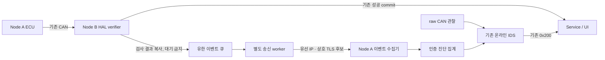

# 인증 이벤트 전달 설계와 사전검증

<!-- 생성 목적: 관련 원문을 카테고리별로 통합하여 탐색을 줄인다. 사용 목적: 원본별 구역과 고유 앵커를 통해 정책·설계·근거를 확인한다. -->

2026-09-10 카테고리 통합. Part 1은 전달 설계, Part 2는 최초 부분 모형의 12개 검사 기록이다. 최신 메시지·상태 규약과 제품 인수는 별도 원본을 따른다. 최초 사전검증을 후보 2 전체나 실장비 검증으로 확대하지 않는다.

기존 본문·표·수치·사용자 결정은 보존했고 제목 단계·참조·앵커만 조정했다. 아래 각 Part의 작성일·완료/미실행 표현은 해당 원문 시점이다. 원문 절 번호는 재번호하지 않았으므로 인용 시 Part 또는 고유 앵커를 함께 사용한다.

| 구역 | 통합 원문 | 원문 SHA-256 |
|---|---|---|
| [Part 1](#delivery-design) | `인증이벤트_전달_설계안.md` | `e4daf253353b54e55fccc496d00149672e72d12df4b0cec79cc9a87af81487a2` |
| [Part 2](#delivery-precheck) | `인증이벤트_전달_사전검증.md` | `ed23bd483c44961859649e1a095b3fd6a25214993a95d2ebcfa8df742cf34e92` |

최신 기준: [메시지·상태 규약](인증이벤트_메시지_상태규약.md#planning-final) · [구현 전 인계](보안계획_구현전_인계_및_진행현황.md#planning-complete).


<a id="delivery-design"></a>

<!-- BEGIN preserved-source:인증이벤트_전달_설계안.md -->
<a id="delivery-design--인증-이벤트-전달-설계안--q2b-후속-구체화"></a>
## 인증 이벤트 전달 설계안 — Q2=B 후속 구체화

> **메시지·상태 규약 후속 — 2026-09-09:** [후보 2 규약](인증이벤트_메시지_상태규약.md)에 5종 메시지, 최초 status 단계, 누적 집계와 ready 경계를 구체화했다. 기존 후보의 부분 필드/구간 요약보다 최신 검토 기준이며 공식 계약 채택은 아니다.

> **후속 사전검증 — 2026-09-09:** [독립 모형 결과](#delivery-precheck)에 12개 검사와 14개 고정 입력, ready 기준 순번·status 순번·유실 이력의 후보 보완을 기록했다. 아래 §10·12의 미생성 설명은 최초 설계 작성 시점 기록이다. 전체 schema·TLS·제품·장비 인수는 미완료다.

작성일: 2026-09-09. 상태: **추천 설계 후보, 상세 계약 미승인·제품 미구현·장비 미검증**.

<a id="delivery-design--1-쉽게-설명한-추천안"></a>
### 1. 쉽게 설명한 추천안

Node B가 CAN 메시지를 검사한 결과를 **별도 유선 네트워크로 Node A에 알려주는 방식**을 우선 추천한다. 양측 신원을 확인하는 TLS 연결 하나를 유지하고, 인증 성공·실패·검사 불가와 전달 상태를 보낸다. Node A는 이 정보를 기존 CAN 관찰과 함께 보안 판단의 근거로 사용한다.

기존 CAN은 BMS와 기존 IDS 경보를 계속 전달한다. 새 경로는 안전 제어 명령을 보내지 않는다. 네트워크가 끊기면 “인증 결과를 확인할 수 없음”으로 기록하고 CAN 관찰과 기존 안전 동작을 계속한다.

이 추천은 Ethernet 연결·Android 네트워크 권한·TLS 빌드 가능성을 확인한다는 조건이다. 실제 연결과 성능이 확인됐다는 뜻이 아니다. Q2=B 선택은 유지하며 통신 수단과 상세 계약의 확정은 별도다.

<a id="delivery-design--2-근거와-현재-상태"></a>
### 2. 근거와 현재 상태

- 사용자 선택 정본: [공동 선택 기준](../../../plan/detail/common/00_협업_규약.md#security-adoption)의 Q2=B. 담당·관문: [공동 연계](../../../plan/detail/common/01_연계_의존성.md#security-adoption).
- [ICD](../../ICD.md) §1.1·1.5·2에 따르면 0x200은 Node A→Node B의 비인증 참고 경보다. 이를 역방향 전송에 재사용하거나 새 필드를 끼워 넣지 않는다. 현행 counter/pending 및 승인 목표/세션 후보의 구분을 유지한다.
- [SDD-IVI](../../SDD-IVI.md) §4는 HAL 내부 verifier를 계획한다. 실제 ivi_platform/에는 목적 안내 README만 있고 제품 소스가 없으므로 아래 IVI 모듈은 모두 예정이다.
- 실제 [특징 추출기](../../../security/ids/feature_extractor.py), [사양 검출기](../../../security/ids/spec_detector.py), [IF 검출기](../../../security/ids/if_detector.py)는 존재한다. 현재 특징 추출 입력은 raw CAN 기반 7개 특징이며 인증 이벤트 입력 경로는 없다. 존재 확인은 동작 검증이 아니다.
- [SDD-ECU](../../SDD-ECU.md)·[ADR](../../ADR.md)의 예정 ids_engine과 실행 계획의 realtime_ids 이름은 구현 시 호출 관계를 확인해 하나로 정한다. 이 설계가 별도 온라인 IDS를 중복 생성하는 근거가 되지 않는다.
- 현재 폴더에는 Git 메타데이터가 없어 브랜치/HEAD를 확인하지 못했다. 이번 설계 작업은 파일 목록·해시로 범위를 확인한다.

<a id="delivery-design--3-전달-수단-비교"></a>
### 3. 전달 수단 비교

다음 평가는 프로젝트 조건에 대한 설계 판단이며 실측 성능 순위가 아니다.

| 후보 | 적용 방법 | 장점 | 부담·한계 | 판단 |
|---|---|---|---|---|
| 추가 CAN 메시지 | 새 역방향 메시지와 인증·분할/조립 정의 | 기존 배선 활용 | ID·DLC·인증·버스 부하 계약 추가, CAN Flood와 동일 장애 경로 | 유선 IP 사용 불가 시 재검토. ID를 지금 할당하지 않음 |
| 유선 IP + 상호 TLS/TCP | Node B client→Node A collector 장기 연결 | 기존 CAN wire를 보존하며 구조화된 진단 전달 | 케이블/연결, 인증서, Android 빌드·권한, 재연결 검증 필요 | **우선 추천 후보** |
| UDP + 별도 인증 | 데이터그램마다 출처·순번·재생 방지 설계 | 메시지별 독립 전달 가능 | 유실·재정렬·재생·키 관리의 추가 설계 필요 | 첫 구현 후보에서 제외 |
| MQTT/gRPC | TLS 위 broker 또는 RPC 사용 | 도구별 메시지 관리 기능 활용 가능 | 현재 없는 런타임/의존성 및 운영 구조 추가 | 현재 규모에서는 도입 근거 부족 |
| 파일·사후 로그 | 시험 후 로그를 합침 | 재현·분석 보완에 유용 | 실시간 전달 선택을 충족하지 않음 | 보조 증거로 유지 |
| Binder/로컬 소켓 | 한 노드 내부 프로세스 연결 | verifier와 송신부 분리 가능 | Node A↔B 통신 자체를 해결하지 않음 | 내부 필요성 확인 후 사용 |

직결 또는 기존 격리 유선망을 활용할 수 있는지 담당자가 확인한다. 새 장비 구매나 공유망 노출을 전제로 하지 않으며 네트워크 준비 실패 시 평문으로 자동 전환하지 않는다.

<a id="delivery-design--4-적용-위치와-흐름"></a>
### 4. 적용 위치와 흐름



| 위치 | 예정 책임 | 보존할 경계 |
|---|---|---|
| Node B 예정 hal/secoc_verifier.cpp | 실제 검사 종료 결과를 내부 기록 구조로 생성 | 성공/실패·counter commit 순서는 ICD 그대로. pending 정책을 변경하지 않음 |
| Node B 예정 HAL 내부 송신 worker | 유한 큐 소비·인증 연결·상태 요약 | verifier/UI 스레드에서 네트워크/파일 I/O 또는 재연결 대기 금지 |
| Node A 예정 security/ids/auth_event_receiver.py | TLS peer 허용, 형식·순번·연결 검증 및 진단 입력 제공 | 원격 이벤트를 CAN 프레임으로 재주입하지 않음 |
| 기존 온라인 IDS의 예정 통합 지점 | raw 검출 결과와 인증 진단을 별도 출처로 연결 | 필수 IF와 현재 7개 특징 유지. 새 특징 자동 추가/재학습 금지 |
| 기존 실험/계측 경로 | 동일 run의 verifier·전달·IDS 입력 증거 연결 | 합성 이벤트와 실제 verifier 결과를 구분 |

위 경로는 배치 후보다. 모듈 분리는 구현 시 최소 단위로 정한다. 우선 HAL 내부 worker를 검토해 공개 HIDL/AIDL API 변경을 피한다. 프로세스 분리가 필요해지면 권한이 제한된 내부 IPC와 신원 확인을 별도 명세로 검토한다. 대시보드 앱이 인증 결과를 대신 만들어 보내지 않는다.

<a id="delivery-design--5-보호와-신뢰-범위"></a>
### 5. 보호와 신뢰 범위

추천 연결은 TLS 1.3과 양측 인증서 검증을 사용한다. Node A는 허용된 Node B 인증서 신원을, Node B는 지정 Node A의 인증서 신원을 확인한다. 같은 CA의 임의 인증서까지 허용하지 않도록 node_id와 인증서 신원의 매핑을 둔다. TLS의 인증·레코드 보호와 0-RTT 재생 한계는 [RFC 8446](https://www.rfc-editor.org/rfc/rfc8446.html)의 §4·5·8에 근거하며, 이 후보는 0-RTT를 사용하지 않는다.

Node A의 Python 표준 ssl을 우선 검토한다. 서버 모드만 설정하면 client 인증이 자동으로 필수가 되는 것은 아니므로 CERT_REQUIRED와 신뢰 체인·허용 신원을 명시한다. 실제 Python/OpenSSL 지원은 실행 환경에서 확인한다. 근거: [Python ssl 문서](https://docs.python.org/3.10/library/ssl.html).

Node B는 선택된 AOSP native 빌드에서 사용 가능한 TLS 라이브러리와 API를 먼저 검증한다. 특정 내부 라이브러리의 링크 가능성을 가정하지 않는다. HAL 도메인의 소켓·인증서 읽기 권한은 최소 범위로 설계하고 SELinux를 끄는 방식으로 해결하지 않는다. 네트워크 권한을 별도 정책으로 다루는 근거: [AOSP SELinux 사용자화](https://source.android.com/docs/security/features/selinux/customize).

인증서 private key는 SecOC 키와 분리하고 저장소·로그에 넣지 않는다. 생성/배포·갱신·폐기·유효 기간·부팅 시 시각 준비는 배포 절차로 남긴다. 시각/인증서 검증 실패 시 연결 실패를 표시하고 검증을 끄지 않는다. 대상 호스트/포트는 배포 시 확정하며 실제 장비 주소를 이 문서에 쓰지 않는다.

TLS로 확인되는 것은 “허용된 Node B가 보낸 보고”다. Node B 자체가 침해되면 거짓 보고가 가능하며 CAN 송신자의 별도 증명이나 ECU 안전 명령 권한이 생기지 않는다. 이 채널의 암호화가 기존 CAN payload나 0x200까지 암호화하는 것도 아니다.

<a id="delivery-design--6-메시지-형식-후보"></a>
### 6. 메시지 형식 후보

아래는 검토 가능한 **버전 1 초안**이다. 공식 wire 번호·HAL 계약을 확정하지 않는다.

TLS byte stream 위에서 길이 접두부(4바이트 unsigned big-endian) + UTF-8 JSON 객체를 권장한다. 수신 길이를 먼저 상한 검사한 후 본문을 할당한다. 한 번의 read를 한 메시지로 간주하지 않는다. 중복 JSON 키, 잘못된 UTF-8, 비유한 수, 타입/필수 필드 오류, 지원하지 않는 버전은 거부한다. 최대 길이·문자열 길이·배열 수는 §9 파일럿으로 확정하며 미설정 상태로 제품 인수를 닫지 않는다.

큰 순번/monotonic 시각은 JSON 숫자의 언어별 정밀도 차이를 피하도록 uint64 범위의 십진 문자열로 표현한다. 논리 식별자/열거형은 문자열, CAN ID는 정수로 두고 해당 계약 버전의 허용 목록과 대조한다. 이벤트에는 실제 키·MAC 원문·전체 payload를 담지 않는 최소 진단을 추천한다.

| 종류/필드 | 의미와 검사 |
|---|---|
| 공통 version, kind | 지원 버전과 hello/challenge/ready/event/status 구분 |
| node_id, producer_epoch | 인증서에 연결된 노드와 verifier 실행 세대. 프로세스 재시작마다 새 epoch, OS 부팅과 동일시하지 않음 |
| connection_id | Node A가 새 인증 연결마다 만드는 예측 불가능 식별자. 이전 연결 값 거부 |
| event_seq | producer_epoch 내 결과마다 먼저 부여하는 증가 순번. 큐에서 버린 결과도 순번 소비 |
| contract_profile, verifier_version | 현행 고정키/승인 목표/세션 후보를 구별하는 설정 식별. 허용 profile만 인수 |
| raw_id, auth_id, counter | 관측 가능할 때만 기록. auth 미수신 등은 null, 0으로 채우지 않음. counter 신뢰 여부 별도 표시 |
| decision, reason | ACCEPTED / REJECTED / NOT_EVALUATED / BYPASSED. 사유와 모순되는 조합 거부 |
| event_mono_ns, emit_mono_ns | Node B 같은 monotonic 시계의 결과 발생·송신 시각 |
| status의 generated_total, dropped_total, expired_total, queue_depth | epoch 시작 이후 누적 카운터와 현재 큐 상태. 감소·초기화는 epoch 전환과 연결 |
| status의 last_event_seq, interval_start/end, accepted/rejected/not_evaluated/bypassed 수 | 무사건·통신 단절 구별과 결과 총수 검산. 누적값/구간값의 범위를 명시 |

사유 후보는 MAC_MISMATCH, COUNTER_REJECT, RAW_EXPIRED, RAW_REPLACED, ORPHAN_AUTH, FORMAT_INVALID, CONFIG_ERROR 등이다. 이는 진단 문자열이며 기존 HAL reason 숫자를 추가/교체하지 않는다. 실제 verifier가 검사하지 않은 MAC을 “MAC 실패”로 보고하지 않고, 검증 전에 버린 입력은 NOT_EVALUATED로 구별한다. 비보안 C0의 BYPASSED를 ACCEPTED로 집계하지 않는다.

성공은 검증 성공 및 기존 상태 commit 후, 거부/검사 불가는 해당 폐기 판단 후 기록한다. raw 보관 중에는 최종 결과를 만들지 않는다. 같은 원본에 여러 auth 시도가 있으면 검사 시도별 결과임을 명시하고 원본 프레임/시행 탐지율과 분모를 섞지 않는다.

<a id="delivery-design--7-연결재생유실복구"></a>
### 7. 연결·재생·유실·복구

1. Node B가 Node A에 연결하고 양측 인증을 마친다. hello로 신원/epoch/profile을 확인한다. Node A는 challenge(connection_id)를 보내고 Node B는 ready로 응답한다.
2. Node B는 ready 시점 이전의 대기 이벤트를 실시간 경로에서 폐기하고 개수를 status에 남긴다. Node A는 해당 연결·신원·epoch의 이후 이벤트만 받는다. 세션을 다시 열어 옛 로그를 실시간 탐지로 재생하지 않는다.
3. 같은 epoch에서는 순번을 되돌리지 않는다. 수신 순번 증가만 허용하고 중복/역순은 입력에 반영하지 않는다. 순번 gap은 손실/불완전으로 기록하며 곧바로 CAN 공격이라고 단정하지 않는다.
4. Node A 재시작 후에는 새 connection_id와 ready 경계를 사용한다. 이전 메모리 중복 이력이 복구됐다고 주장하지 않는다. 동일 신원의 중복 활성 연결은 우선 거부하고 기존 연결을 보존한다. 오래된 연결 종료/만료 후 재인증한다.
5. TCP 재전송과 별개로 애플리케이션 수준의 이벤트 재전송/영구 backlog는 첫 후보에서 사용하지 않는다. 송신 성공은 IDS 소비 성공이 아니다. 실험에서는 event ID별 producer/receiver/IDS 소비 로그를 대조한다. 정확히 한 번 전달을 보장한다고 표현하지 않는다.
6. producer queue가 차거나 오래된 항목이 생기면 폐기 수를 누적하고 수신 가능할 때 status로 보고한다. Node A의 수신/검출기 큐도 독립 상한과 drop 계수를 갖는다. status는 무한히 적재하지 않고 최신 snapshot 하나로 교체한다.
7. 일정 기간 유효 status/event가 없으면 진단 입력을 UNAVAILABLE, gap/drop이 있으면 INCOMPLETE로 표시한다. 소켓 연결만으로 정상으로 복구하지 않는다. 유효 ready/status와 새 이벤트 구간으로 가용성을 회복하되 과거 손실 기록은 보존한다.
8. 재연결 간격/최대 대기·시도량을 제한하고 CAN 수신·UI를 기다리게 하지 않는다. 장애 중 로컬 로그도 회전/상한을 둔다. 디스크 실패가 verifier를 막지 않는다.

이벤트 발생부터 Node B 송신까지의 나이는 같은 시계로 검사한다. Node A는 자신의 수신 후 큐 대기를 측정한다. 노드 간 monotonic 값을 직접 빼지 않는다. 네트워크 내 지연까지 포함한 freshness는 시계 정렬 오차 또는 검증된 왕복 측정 가정이 필요하므로, 근거 없는 절대 지연 보장은 하지 않는다.

<a id="delivery-design--8-ids와-연결하는-범위"></a>
### 8. IDS와 연결하는 범위

인증 진단은 초기에는 **별도 규칙/근거 입력**으로 사용한다. 최근 구간의 결과 수·사유·연속 거부와 채널 가용성을 보존하고 raw CAN 기반 결과와 같은 run의 Findings에 연결한다. IF 특징 수나 기존 모델을 바꾸지 않는다.

어떤 조합을 최종 공격 탐지로 볼지와 임계값은 정상/공격 파일럿 및 기존 평가 단위를 기준으로 고정한다. 인증 실패 한 건을 즉시 특정 공격명으로 확정하지 않는다. counter 거부도 구세션·지연·재시작 등 여러 원인이 가능하다.

초기 진단 사유를 기존 0x200 type/score에 억지로 매핑하지 않는다. 기존 IDS 경보는 현재 계약으로 유지하고 새 진단은 내부/실험 로그에 남긴다. 새 사유의 UI 경보까지 요구되면 0x200·송신·수신·화면·시험에 대한 별도 변경안을 준비한다. Q2는 실제 IDS 진단 소비까지 입증해야 하며 collector 파일 저장만으로 완료되지 않는다.

<a id="delivery-design--9-운영값을-확정할-파일럿"></a>
### 9. 운영값을 확정할 파일럿

| 미확정 항목 | 측정/결정 방법 | 담당 |
|---|---|---|
| 대상 연결·주소/포트·인증서·TLS 지원 | 실제 양측 링크, 선택 AOSP 빌드·권한, 상호 인증 확인 | IVI + ECU |
| 메시지/문자열/큐 상한 | 정상·실패 버스트의 생성량/크기·메모리와 소비량 측정, 최대 합법 메시지 수용/초과 거부 | 양측 |
| 전송/요약 빈도·age·heartbeat timeout | 지연·CPU·drop과 기존 BMS/UI 지연 동시 측정 | IVI 계측 + ECU |
| 재연결/handshake/read 기한 | 단절·느린 peer·부분 메시지에서 복구와 자원 상한 검증 | 양측 |
| 집계 윈도우·탐지 임계 | 정상 calibration 후 고정, 평가 데이터 재조정 금지 | ECU IDS |
| 시계/순번·counter 포화 | 시계 기준과 오차, uint64 소진 시 새 epoch/연결 전환 시험 | 공동 |

숫자는 설정 후보→파일럿 근거→합의값 순으로 기록한다. 여기서 새로운 지연/탐지율 목표를 만들어 기존 SRS/TEST_PLAN을 대체하지 않는다. 실제 시행 규모와 Q1/Q3 선택은 유지한다.

<a id="delivery-design--10-실행-순서와-인수-사례"></a>
### 10. 실행 순서와 인수 사례

| 순서 | 할 일 | 종료 증거 |
|---|---|---|
| 1 | 장비 링크/TLS/Android 권한 가능성 확인, 후보 비교 검토 | 환경 결과와 추천 수단의 적용 가능/불가 근거 |
| 2 | 형식·사유·연결 상태 및 상한 설정의 독립 계약 fixture 준비 | 아래 보조 사례의 기대 결과와 양측 동일 해석 |
| 3 | 필요한 상세 계약을 확정하고 공식 문서 영향 동기화 | §11 변경 목록과 합의 기록 |
| 4 | verifier 결과 생산→worker→collector→IDS 진단 소비 구현 | 양측 모듈 단위/호스트 통합 결과 |
| 5 | 실 CAN·IVI와 함께 실패/복구·부하 검증 | 동일 run 계측, 기존 기능 회귀 및 미달/invalid 기록 |

호스트 fixture 준비는 제품 전환 전에 독립 진행 가능하다. 실제 테스트 코드·fixture는 이번 문서 작성에서 생성/실행하지 않았다.

| 보조 사례 ID | 입력/상황 | 기대 결과 |
|---|---|---|
| Q2-D01 | 정상 성공·MAC 불일치·counter 거부·C0 | 실제 verifier 결과와 IDS 진단 분류 일치, 기본 commit 불변 |
| Q2-D02 | 인증서 없음/오류/다른 허용 외 노드·신원 위장 | 채널 거부, 진단 입력 0건, 정상 CAN 경로 유지 |
| Q2-D03 | 분할/연속 메시지·큰 길이·중복 키·잘못된 타입/버전 | 정상 framing만 처리, 비정상 입력의 유한 시간/메모리 거부 |
| Q2-D04 | 중복/역순/gap·이전 connection·producer 재시작 | 중복 미반영, 손실 표시, 새 연결 경계 이전 자료 미반영 |
| Q2-D05 | 단절·재연결·collector 재시작·동시 연결 | UNAVAILABLE/INCOMPLETE 구별, backlog 재생 없음, 무한 재시도 없음 |
| Q2-D06 | 큐 포화·느린 reader·디스크 실패 | drop 계수/유한 자원, verifier·UI 비차단, 기존 성능 회귀 확인 |
| Q2-D07 | 시계 차이·status만 지속·실제 CAN 미수신 | 전달 가용성과 CAN freshness 구별, 근거 없는 지연 계산 없음 |
| Q2-D08 | 실제 공격/정상 입력과 실시간 이벤트 소비 | producer→receiver→IDS 근거 일치, 기존 raw/IF 검출 유지 |

Q2-D는 이 설계의 로컬 보조 ID이며 공식 TC가 아니다. 인증은 TC-SEC-002/003/004, IDS·경보는 TC-SEC-006/007, 연결은 TC-INT-002/004, 성능은 TC-PERF-001/003과 회귀 관계를 갖는다. 공식 합격 기준은 [TEST_PLAN](../../TEST_PLAN.md)이 정본이다. 모형 성공을 Android/실장비 인수로 바꾸지 않는다.

<a id="delivery-design--11-상세-승인-때-함께-검토할-영향"></a>
### 11. 상세 승인 때 함께 검토할 영향

| 문서/영역 | 추천안 채택 시 변경할 내용 | 이번 작업 상태 |
|---|---|---|
| ICD | 별도 IP 진단 계약의 위치/범위와 버전 연결. 기존 CAN 표·SecOC 입력·HAL API 보존 여부 확인 | 미변경 |
| SRS·양측 SDD | Q2 진단 생산/소비·장애 경계, 모듈·권한·자원 설계 | 미변경 |
| ADR·TARA | 후보 비교 채택 근거, endpoint 침해·인증서·망 가용성의 잔여 위험 | 미변경 |
| TEST_PLAN | Q2 보조 사례의 공식 추적/인수 기준, 기존 TC 회귀 | 미변경 |
| 제품·의존성·배포 | verifier hook 지점, worker/receiver, TLS 지원·권한·비밀 공급 | 미구현 |
| 현행 실행 계획 | 이 설계로 들어오는 안내 링크 | 이번 작업에서 추가 |

여기서 verifier hook은 내부 결과 기록 지점을 뜻하며 AI 도구 hook 설정과 관계없다. 상위 지침의 인터페이스 변경 절차는 실제 계약을 전환할 때 적용한다. 지금은 검토할 후보를 구체화한 상태이며, 미검증 운영값까지 일괄 승인됐다고 취급하지 않는다.

<a id="delivery-design--12-이번-작업의-완료-범위"></a>
### 12. 이번 작업의 완료 범위

수단 비교, 추천 구조, 메시지 의미/형식 후보, 보호·유실·재부팅 정책, 담당·파일럿·보조 인수 사례와 계약 영향안을 작성했다. 링크/앵커·참조 ID·코드 펜스 및 변경 범위를 검사한다. 네트워크 연결·인증서 생성·의존성 설치·제품 구현·장비 시험은 수행하지 않았다.

다음 독립 작업은 §10의 fixture와 상태 전이 기대값을 준비하는 것이다. 실제 통신 수단 확정은 장비 적용 가능성과 §9 운영값 근거를 확인한 뒤 이 후보를 기준으로 검토한다. 서버 소스 가져오기는 기존 사용자 담당 범위를 유지한다.

<!-- END preserved-source:인증이벤트_전달_설계안.md -->


<a id="delivery-precheck"></a>

<!-- BEGIN preserved-source:인증이벤트_전달_사전검증.md -->
<a id="delivery-precheck--인증-이벤트-전달-사전검증--후보-규칙과-기대-결과"></a>
## 인증 이벤트 전달 사전검증 — 후보 규칙과 기대 결과

> **후속 검증:** [메시지·상태 규약 후보 2](인증이벤트_메시지_상태규약.md)에서 전체 5종 필드와 상태/집계 검사를 추가했다. 아래 12개 검사는 최초 부분 모형의 결과로 보존하며 후보 2는 별도 18개 검사 결과를 따른다.

작성일: 2026-09-09. **설계 모형 검사 결과이며 제품·TLS·CAN·Android 인수 결과가 아니다.**

<a id="delivery-precheck--1-수행-결과"></a>
### 1. 수행 결과

[설계안](#delivery-design) Q2-D01~D08을 실행 가능한 부분과 실제 구현이 필요한 부분으로 나눴다. Python 3.14.3에서 표준 라이브러리 unittest로 **12개 검사 통과**를 확인했다. 그중 메시지 분류 검사는 [fixture](../q2_validation/fixtures.json)의 **14개 고정 입력**을 대조한다. 14개를 별도 14개 테스트 함수나 공식 TC 통과로 합산하지 않는다.

재현 명령(저장소 루트):

```text
python -B docs/development/q2_validation/check_design.py
```

[검증 스크립트](../q2_validation/check_design.py)는 fixture와 작은 수신 상태 모형만 사용한다. 파일의 위치는 보존용 문서 부속 자료이며 제품 모듈이 아니다. 네트워크 연결·인증서 생성·패키지 설치·제품 코드 import를 수행하지 않는다.

<a id="delivery-precheck--2-검증-과정에서-구체화한-후보-규칙"></a>
### 2. 검증 과정에서 구체화한 후보 규칙

기존 설계안에 충분히 정해지지 않았던 부분을 아래와 같이 모형에 명시했다. **후보 규칙이며 공식 계약 변경이 아니다.**

| 보완점 | 모호한 상태에서의 문제 | 이번 모형의 규칙 |
|---|---|---|
| ready 경계의 기준 순번 | 새 연결의 첫 순번이 커도 정상 연속인지 재연결 전 backlog인지 구분 불가 | ready에 cutoff_seq를 전달하는 후보. producer가 기존 큐 폐기와 기준 순번 snapshot을 같은 경계로 처리하고 이후 결과부터 enqueue. receiver는 cutoff 이하 거부 |
| 상태 보고의 순번 | 같은 status를 반복해도 마지막 수신 시각이 갱신되면 끊어진 생산자를 정상으로 오인 가능 | connection별 status_seq 증가만 수용. 중복·잘못된 이벤트/status는 가용성 시계 갱신 금지 |
| 현재 상태와 유실 이력 | 한 번 유실 후 영구 장애로 남거나 재연결로 과거 손실까지 삭제 가능 | 현재 연결의 AVAILABLE/INCOMPLETE/UNAVAILABLE과 history_loss를 분리. 재연결은 현재 구간만 새로 시작 |
| 수신 이후 대기 | 송신 시점에는 신선한 이벤트도 Node A 큐에서 오래 대기 가능 | Node A 자신의 monotonic 기준으로 큐 나이 검사. 오래된 결과는 IDS 소비에서 제외 |
| timeout 경계 | 기한 정각에 유효/만료 해석이 다를 수 있음 | 모형은 heartbeat 경과가 한도 이상이면 UNAVAILABLE. source/consumer age는 한도 초과에서 폐기 |
| 의미별 사유 | ACCEPTED에 MAC_MISMATCH가 붙거나 C0가 정상 인증으로 집계 가능 | decision/reason 허용 조합을 따로 검증. VERIFIED·SECURITY_DISABLED는 fixture 후보 문자열 |

cutoff_seq·status_seq는 설계안 §6의 기존 표에 추가 검토할 후보 필드다. 실제 ready의 원자성, worker/producer 경쟁, status 신원·connection·형식 검사는 제품 구현에서 별도 시험해야 한다. 고정 TEST_CONN 값은 재현용 더미다. 실제 연결 식별자의 난수성이나 TLS 세션 결합을 검증한 것이 아니다.

현재 모형은 연결 중 손실이 생기면 그 연결을 INCOMPLETE로 유지한다. 새 연결에서 현재 가용성은 회복할 수 있지만 history_loss는 남는다. 이는 “해당 연결의 관측 완전성” 정의이며 CAN freshness나 IDS 탐지 성공과 별개다.

<a id="delivery-precheck--3-입력예상-결과-대조"></a>
### 3. 입력·예상 결과 대조

fixture의 상한 2048, 큐 크기 2, age 10, heartbeat 20은 **작은 경계 시험을 위한 임의 시험값**이다. ns 필드와 가상 수신 시계를 사용하며 측정된 성능·제품 목표·실제 timeout을 뜻하지 않는다. 원자료의 성능 수치를 가져오지 않았다.

| 고정 입력 ID | 내용 | 기대 결과 |
|---|---|---|
| F01 | ACCEPTED + VERIFIED | 인증 성공 분류 |
| F02/F03 | REJECTED + MAC_MISMATCH/COUNTER_REJECT | 실패 사유별 분류 |
| F04 | BYPASSED + SECURITY_DISABLED | 우회 분류, 인증 성공과 구분 |
| F05 | NOT_EVALUATED + ORPHAN_AUTH | 검사 불가 분류 |
| F06 | 성공 결과와 실패 사유 혼합 | 거부 |
| F07/F08 | bool 또는 지원하지 않는 version | 거부 |
| F09/F10/F11 | uint64 초과/숫자형/음수 순번 | 거부 |
| F12 | emit이 event보다 과거 | 거부 |
| F13/F14 | source age 한도 정각/초과 | 정각 허용, 초과 거부 |

모형은 메시지 필드의 부분집합만 다룬다. contract_profile/verifier_version, CAN ID 쌍·counter 신뢰, 전체 status 카운터와 구간 합계, hello/challenge/ready 실제 wire 인코딩, 최대 문자열/JSON 깊이의 제품 한도는 아직 완전한 schema로 검증하지 않았다. 스크립트를 그대로 제품 parser로 복사하지 않는다.

<a id="delivery-precheck--4-12개-검사와-남은-인수"></a>
### 4. 12개 검사와 남은 인수

| 검사 함수의 test_ 이후 이름 | 확인한 범위 |
|---|---|
| fixture_decisions_and_boundaries | 14개 고정 입력의 decision·형식·source age |
| fragmentation_every_split_and_concatenation | 두 메시지를 이어 붙인 byte stream의 모든 2분할 위치에서 동일 결과 |
| reject_duplicate_utf8_nonfinite_nested_and_missing | 중복 JSON 키·UTF-8 오류·NaN·비객체·필드 누락·한도보다 큰 중첩 입력 거부 |
| length_and_truncated_stream | 길이 0/상한 초과/uint32 최대값 거부, 잘린 본문 EOF 거부 |
| unauthorized_identity_and_duplicate_connection | 입력으로 주어진 허용 외 신원·중복 연결 거부. 인증서 검증은 모형 밖 |
| cutoff_duplicate_reverse_gap_and_invalid_no_refresh | ready cutoff·중복·역순 거부, gap은 불완전, 중복의 가용성 시계 갱신 금지 |
| old_connection_epoch_and_node_rejected | 이전 connection/epoch·다른 노드 거부 후 기준 순번 보존 |
| reconnect_drops_backlog_and_keeps_loss_history | 이전 대기 자료 소비 방지, 새 연결의 현재 상태와 과거 유실 이력 분리 |
| receiver_restart_and_new_producer_epoch | 새 receiver/epoch/connection에서 이전 메시지 거부 |
| bounded_queue_and_expired_consumer | 수신 큐 상한과 소비 시 나이 초과 폐기 |
| status_duplicate_timeout_boundary_and_drop_monotonicity | status 중복·drop 감소 거부, timeout 직전/정각 |
| clock_domains_and_receive_is_not_consume | 노드별 시각 직접 차감 없음, 수신과 모형 consumer 소비 별도 기록 |

| 설계 사례 | 이번 확인 수준 | 실제 구현에서 남은 확인 |
|---|---|---|
| Q2-D01 | 합성 결과 분류만 확인 | 실제 SecOC 결과·counter commit과 producer 출력 일치 |
| Q2-D02 | 허용 신원 분기의 논리만 확인 | TLS handshake·양측 인증서·신원 매핑·실패 시 데이터 차단 |
| Q2-D03 | 부분 event schema와 메모리 framing 확인 | 전체 schema, 느린 read/handshake 기한·CPU/RSS 상한 |
| Q2-D04 | 순번·gap·connection/epoch 분리 모형 확인 | producer ready 경계 원자성·실제 동시 입력/재부팅 |
| Q2-D05 | 재연결·timeout 상태 모형 확인 | 네트워크 단절·재시도 상한·실제 backlog 정책 |
| Q2-D06 | receiver 유한 큐·소비 만료 모형 확인 | producer/status 큐·디스크 실패·스레드 비차단·부하 회귀 |
| Q2-D07 | 가상 시계와 채널 가용성 분리 확인 | 실제 시계 오차·CAN stale·UI 표시 동시 계측 |
| Q2-D08 | 모형 consumer의 event ID 기록 확인 | 실제 공격→verifier→전달→Node A IDS 소비·raw/IF 회귀 |

따라서 **Q2-D01~D08 전체 통과라고 판정하지 않는다.** 모형에 없는 안전 상태나 CAN freshness가 변경되지 않는다는 제품 증명도 하지 않는다. 기존 공식 TC는 이번 실행으로 체크하지 않았다.

<a id="delivery-precheck--5-다음-작업"></a>
### 5. 다음 작업

먼저 위 후보 필드와 전체 메시지 schema·상태 전이 표를 양측 구현의 공통 입력으로 완성한다. 신원/epoch/profile·누적 status의 일관성, producer/consumer drop의 서로 다른 집계, ready와 생성의 경쟁을 보강한다. 실제 전송은 장비·AOSP TLS/권한 가능성과 운영값 근거를 확보하고 상세 계약 검토를 거친다.

제품 코드와 공식 ICD/SRS/SDD/TEST_PLAN은 이번 작업에서 변경하지 않았다. 실제 장비에 접근하지 못한 부분을 모형 테스트로 대체하지 않았다.

<!-- END preserved-source:인증이벤트_전달_사전검증.md -->
